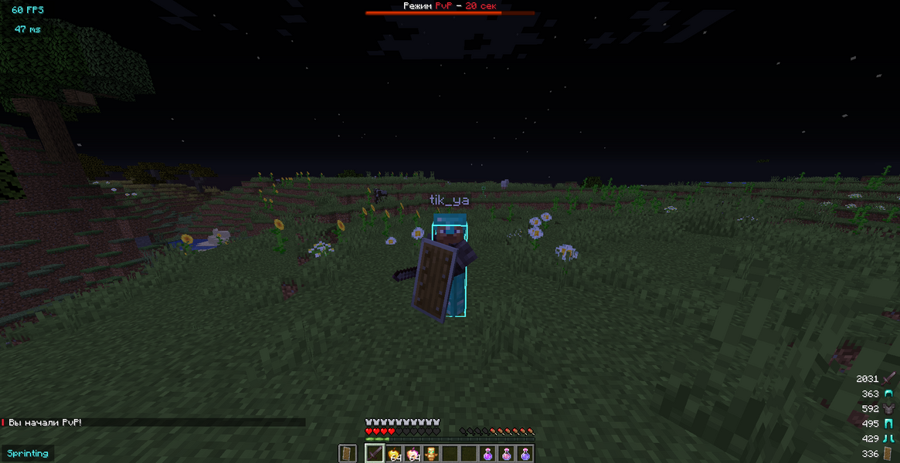
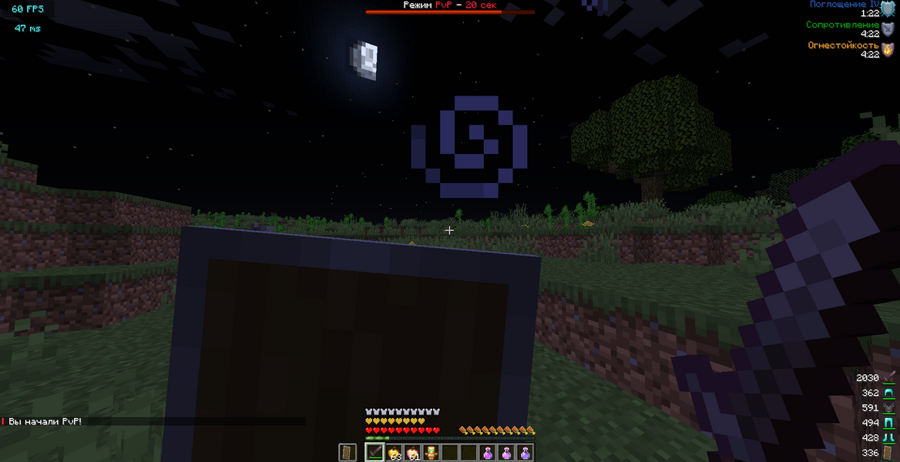

<div align="center">

# PowerAntiRelog

**A combat-log protection plugin for Minecraft. Players who leave during PvP lose their items.**

[](LICENSE.md)


</div>

---

## Why PowerAntiRelog

Combat logging ruins PvP: a player who is losing simply disconnects and keeps their loot. PowerAntiRelog puts both fighters into a **battle mode**. If someone leaves the server while it is active, all their items drop on the ground, which makes PvP fair again.

- **Battle mode** with a boss bar and an optional scoreboard (attacker, attacker HP, time left).
- **Drop-on-leave**: the player is killed and their resources are left on the ground.
- **Configurable restrictions**: disable fly, speed, gamemode, elytra and more, and block commands, teleports, ender chests and interactions during combat.
- **Item cooldowns** for golden apples, ender pearls, chorus fruit, totems, tridents, wind charges and others.
- **Axe shield-break** mechanic with its own cooldown.
- **Newbie protection** (optional) with an AFK-aware timer and WorldGuard region restrictions.
- **Start/end commands** for custom integrations.
- **Translations** included (`en`, `ru`) in [`translations/`](translations).
- **Paper and Folia** natively supported.
- Optional integration with **WorldGuard**, **CMI**, **Essentials**, and **PlaceholderAPI**.

## Installation

1. Download or build the JAR (see [Building](#building)).
2. Put it into your server's `plugins/` folder.
3. Start the server and edit `plugins/PowerAntiRelog/config.yml` if needed.

**Requirements:** Paper / Folia 1.21+ and Java 21.

> [!NOTE]
> For Minecraft 1.16.5 and other legacy versions, please use the [1.6.1-RELEASE](https://github.com/katze225/PowerAntiRelog/releases) build.

## Commands & permissions

| Command | Description | Permission |
|---------|-------------|------------|
| `/ar help` | List of commands | `powerantirelog.help` |
| `/ar reload` | Reload the configuration | `powerantirelog.reload` |
| `/ar test <player>` | Put a player into battle mode | `powerantirelog.test` |
| `/newbie <enable\|disable>` | Toggle newbie protection | n/a |

`powerantirelog.bypass`: the player is never put into battle mode.


## Placeholders (PlaceholderAPI)

| Placeholder | Description |
|-------------|-------------|
| `%powerantirelog_in_pvp%` | In combat state (`true`/`false`) |
| `%powerantirelog_time%` | Remaining combat time in seconds |
| `%powerantirelog_attacker%` | Attacker name |
| `%powerantirelog_attacker_health%` | Attacker health |
| `%powerantirelog_newbie%` | Newbie protection state (`true`/`false`) |
| `%powerantirelog_newbie_time%` | Remaining newbie protection in seconds |
| `%powerantirelog_newbie_time_formatted%` | Formatted newbie protection time (`MM:SS`) |

## Screenshots

<p align="center">
  
  
</p>

## Building

```bash
mvn clean package
```

The JAR is written to `target/`.

## Support & contact

- Telegram: [@core2k21](https://t.me/core2k21)
- Discord: `tik_ya`

## Author

Developed by **katze225** ([@core2k21](https://t.me/core2k21)).

## License

Released under the [Mozilla Public License 2.0](LICENSE.md).
